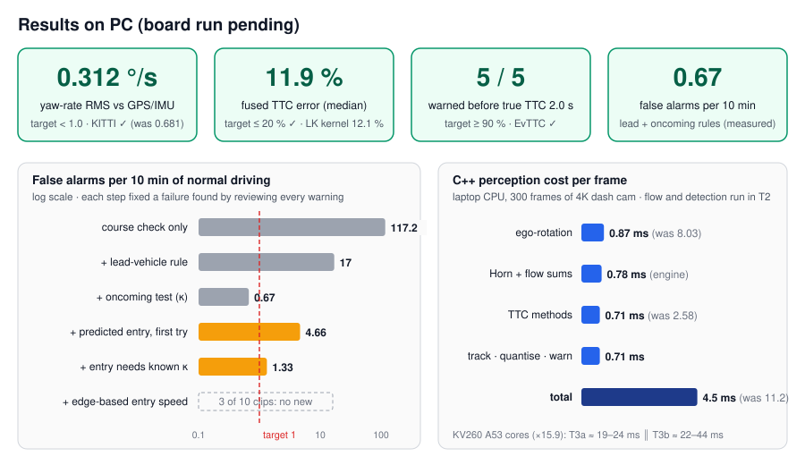
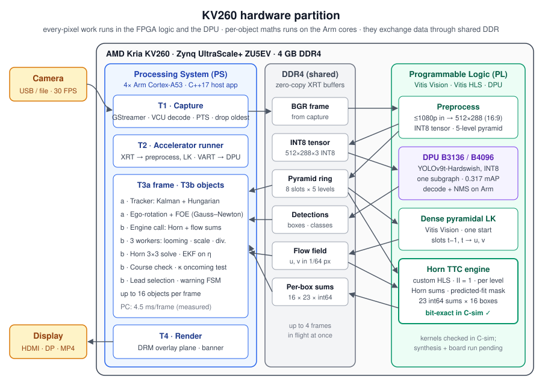
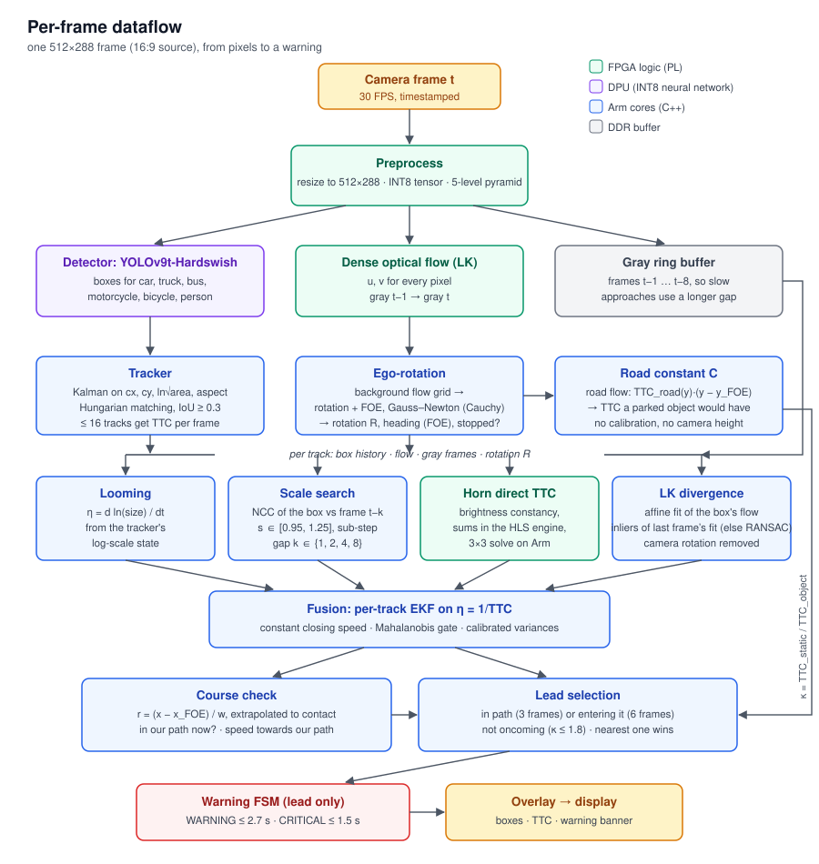
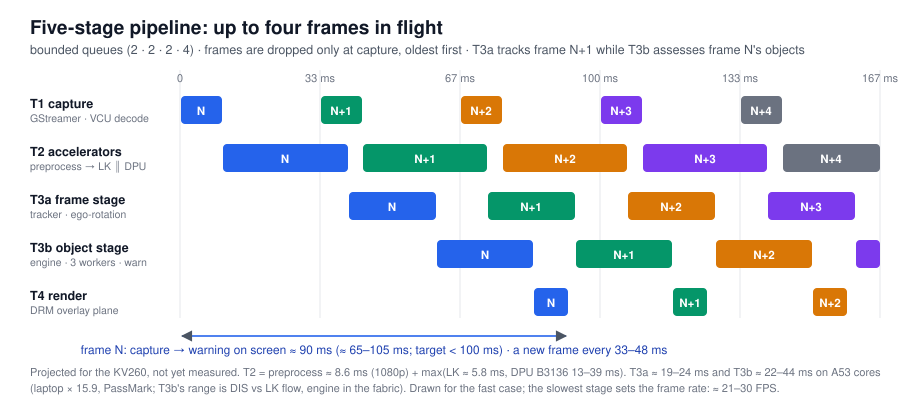
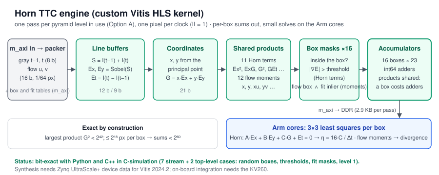
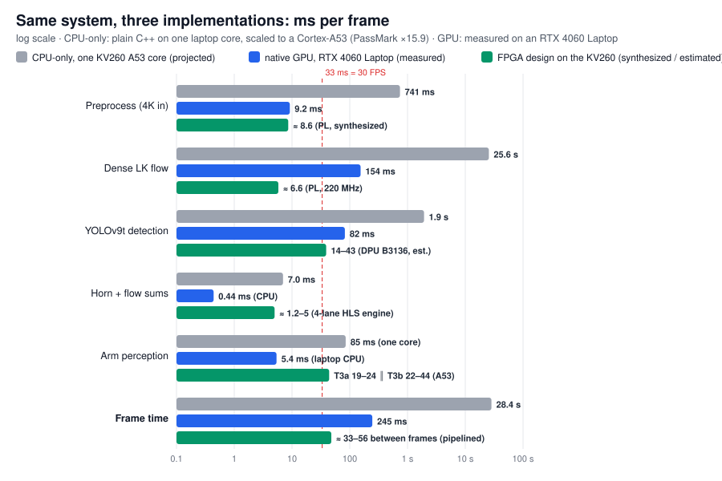

# Monocular Forward-Collision Warning on the AMD Kria KV260

**One camera. No radar, no lidar, no speed signal.** This project estimates, for every road user in front of the vehicle, *how many seconds remain until impact* (time to collision, TTC), decides which one is actually in our way, and warns the driver in time. It does this with optical flow and image geometry rather than distance measurements, and it is built to run on an AMD Kria KV260: per-pixel work goes to the FPGA fabric and the DPU, per-object reasoning to the Arm cores.

<p align="center">
  
  <br/>
  <sub>Real footage from the EvTTC dataset (a test car approached at constant speed). Left: the first WARNING, at true TTC 3.40 s (estimated 2.61 s). Right: CRITICAL ("BRAKE") at true TTC 1.38 s, estimated 1.34 s. Cyan: our heading and driving corridor. YOLOv9t labels the test car "bus"; the class only sets a width prior.</sub>
</p>

---

## Contents

1. [Results at a glance](#results-at-a-glance)
2. [CPU vs GPU vs FPGA: all the numbers](#cpu-vs-gpu-vs-fpga-all-the-numbers)
3. [The problem, and why it is hard with one camera](#the-problem-and-why-it-is-hard-with-one-camera)
4. [System architecture on the KV260](#system-architecture-on-the-kv260)
5. [Per-frame dataflow](#per-frame-dataflow)
6. [How each stage works](#how-each-stage-works)
7. [Who is allowed to warn: lead selection](#who-is-allowed-to-warn-lead-selection)
8. [Five-stage pipelined runtime](#five-stage-pipelined-runtime)
9. [The custom HLS engine](#the-custom-hls-engine)
10. [How correctness is verified](#how-correctness-is-verified)
11. [Results in detail](#results-in-detail)
12. [Repository structure](#repository-structure)
13. [Getting started](#getting-started)
14. [Status and roadmap](#status-and-roadmap)
15. [Earlier pipeline (2025)](#earlier-pipeline-2025)
16. [Contributors and acknowledgments](#contributors-and-acknowledgments)

---

## Results at a glance

<p align="center"></p>

| What | Target | Measured | |
|---|---|---|---|
| Camera rotation (yaw rate) vs KITTI GPS/IMU | < 1.0 °/s RMS | **0.312 °/s** (805 frame pairs, 3 drives; was 0.681). **0.670 °/s** with AMD's LK kernel at the board's 512×160 | ✅ |
| Fused TTC error, real approaches (EvTTC) | ≤ 20 % median | **11.9 %** with DIS flow · **12.1 %** with AMD's LK kernel | ✅ |
| Approaches warned before true TTC 2.0 s (EvTTC) | ≥ 90 % | **100 %** (5 of 5, with either flow) | ✅ |
| False alarms in normal driving (30 min dash cam) | < 1 per 10 min | **0.67 per 10 min** (2 in 30 min) with the lead-vehicle and oncoming rules. The version with predicted path entry was re-checked on 3 of the 10 clips: 1 warning, the same one the earlier version raised. Not re-run after the pipelined redesign | ✅ / partial |
| Crossing pedestrian / car cutting in (synthetic road) | warn by TTC 1.5 s | **warns at ≈ 2.3 s** (was 0.80 s / 0.86 s) | ✅ |
| Perception cost, C++ on a laptop CPU | — | **4.5 ms per frame** through the pipelined perception (was 11.2) | |
| Same work on KV260 Cortex-A53 cores (×15.9, PassMark) | 33 ms per stage for 30 FPS | T3a ≈ 19–24 ms ∥ T3b ≈ 29–56 ms (Horn on the A53, as in the built overlay) → **≈ 18–30 FPS** (was one serial 120–180 ms stage, 6–8 FPS) | ⏳ board run pending |
| **Whole system: FPGA design vs CPU-only (A53)** | — | **≈ 33–56 ms vs 28.4 s per frame: ≈ 510–860× faster, ≈ 250–650× less energy per frame** (projected, see [FPGA design vs CPU-only vs GPU](#fpga-design-vs-cpu-only-vs-gpu)) | |
| **Whole system: FPGA design vs native GPU (RTX 4060 Laptop, measured)** | — | **≈ 33–56 ms vs 245 ms per frame (≈ 4.4–7.4×), 10–15 W vs 47.7 W, ≈ 14–35× less energy per frame** | |
| HLS kernels in C-simulation | bit-exact | **Horn engine 9 / 9 cases · LK wrapper 0 of 147,456 words differ · preprocess gray, tensor, pyramid exact** | ✅ |
| Python ↔ C++ parity, parallel = serial | identical decisions | **59 / 59 GoogleTest tests** | ✅ |

Everything above is measured on a PC. The overlay is built and meets timing, but **the KV260 board run has not happened yet** (see [Status](#status-and-roadmap)). The FPGA projections use the built overlay's clocks (kernels 220 MHz, DPU 275 MHz) and its Horn engine on the A53.

---

## CPU vs GPU vs FPGA: all the numbers

The same system built three ways: **CPU-only** (plain native C++, no accelerators), **native GPU** (the same stages on CUDA through PyTorch, without vendor tuning) and the **FPGA design** (Vitis Vision LK in the fabric, YOLOv9t on the DPU, per-object work and the Horn sums on the Arm cores; the Horn engine is left out of the built overlay for space). How each was measured: [FPGA design vs CPU-only vs GPU](#fpga-design-vs-cpu-only-vs-gpu).

Labels: **measured** on this project's laptop (Ryzen 7 7435HS, RTX 4060 Laptop) · **scaled**: a laptop single-core measurement × 15.9 (PassMark single-thread, Ryzen 7 7435HS 3124 vs Cortex-A53 1.33 GHz 196) · **projected**: published figures or calculation for the KV260, which has not been run yet.

The FPGA design is a five-stage pipeline, so its time per frame is the time **between** frames, set by the slowest stage. A frame's own trip from capture to warning takes ≈ 75–120 ms. The CPU-only and GPU versions run their stages one after the other.

### Whole system, per frame

| | CPU-only, KV260 A53 core (scaled) | CPU-only, laptop core (measured) | Native GPU, RTX 4060 Laptop (measured) | **FPGA design, KV260** (projected) |
|---|---|---|---|---|
| Time per frame | ≈ 28.4 s | 1.78 s | 245 ms | **≈ 33–56 ms** |
| Frames per second | 0.035 | 0.56 | 4.1 | **≈ 18–30** |
| Power | ≈ 7.5 W (board) | not measured | 47.7 W (GPU board only; 15 W idle) | **10–15 W (whole board)** |
| Energy per frame | ≈ 213 J | not measured | 11.7 J (GPU only) | **≈ 0.33–0.84 J** |

### Relative to the FPGA design

| FPGA design compared with … | Speed-up | Energy saving per frame | Power |
|---|---|---|---|
| CPU-only on the same KV260 (A53) | **≈ 510–860×** | **≈ 250–650×** | the FPGA design draws 1.3–2× more, but finishes 510–860× sooner |
| CPU-only on a laptop core | ≈ 32–54× | not measured | — |
| Native GPU, RTX 4060 Laptop | **≈ 4.4–7.4×**. If the GPU version were pipelined too, its 154 ms LK would bound it: ≈ 2.8–4.7× | **≈ 14–35×** (vs the GPU alone) | **3.2–4.8× less** (whole KV260 board vs the GPU board alone) |

### Per stage, ms per frame

| Stage | CPU-only, A53 (scaled) | CPU-only, laptop core (measured) | Native GPU (measured) | FPGA design (projected) | FPGA vs A53 | FPGA vs laptop CPU | FPGA vs GPU |
|---|---|---|---|---|---|---|---|
| Preprocess (4K → processing size, gray, tensor) | 741 | 46.6 | 9.2 | ≈ 9.8 (≤ 1080p in, 220 MHz) | ≈ 76× | ≈ 4.8× | ≈ 0.9× |
| Dense pyramidal LK flow | 25,614 | 1,611 (plain) · 1,505 (OpenCV) | 154 | ≈ 6.6 (220 MHz) | **≈ 3,900×** | ≈ 240× | **≈ 23×** |
| YOLOv9t detection | 1,935 | 121 | 82 | ≈ 14–43 (DPU B3136, 275 MHz) | ≈ 45–140× | ≈ 2.8–8.6× | ≈ 1.9–5.9× |
| Horn sums + flow moments | 7.0 | 0.44 | 0.44 (CPU) | ≈ 7 (on the A53; the PL engine would take ≈ 1.2–5) | 1× | | |
| Perception on the Arm cores | 85 (one core, serial) | 5.4 | 5.4 (laptop CPU) | T3a ≈ 24 ∥ T3b ≈ 29–56 | | | |
| **Frame** | **28,370** | **1,784** | **245** | **≈ 33–56** (slowest stage) | **≈ 510–860×** | **≈ 32–54×** | **≈ 4.4–7.4×** |

The GPU and accelerator rows (preprocess, LK, YOLO) are from the earlier measurement at 512×384. The CPU-only rows were re-measured on the final code at 512×288 (`fcw_cpu_baseline`, 30 frames).

**What the numbers say**

- **Dense optical flow is the reason for the FPGA.** It is 90 % of the CPU-only frame and 63 % of the GPU frame. In the fabric it takes ≈ 6.6 ms per frame (synthesized cycle count at the overlay's 220 MHz): ≈ 3,900× faster than an A53 core and ≈ 23× faster than the GPU version, at ≈ 0.7 W.
- **The DPU makes the detector real-time** on a 10–15 W board: ≈ 45–140× faster than an A53 core.
- **Pipelining removed the Arm bottleneck.** Perception used to be one serial stage of 120–180 ms on one A53 core.
  - It is now two stages on their own cores, with the object stage spread over 3 workers.
  - The Arm work itself is ≈ 30 % smaller: 5.4 against 7.5 ms on the laptop.
  - The largest remaining unknown is divergence on LK flow: 1.86 ms per frame on the laptop, against 0.40 ms on DIS flow. That makes T3b a range of 22–44 ms with the Horn engine in the fabric, 29–56 ms with it on the A53, to be profiled on the board.
- **Small stages gain little from hardware.** The engine is about as fast as software for a few boxes on the laptop. On the A53 it would save ≈ 7–12 ms of T3b and keep that cost flat as objects or resolution grow, but it does not fit next to the DPU, LK and preprocess in the linked overlay (BRAM), so the built overlay runs Horn in software.
- **Energy:** the FPGA design draws more power than the A53 alone and less than a third of the GPU's. Per frame it needs **≈ 250–650× less energy than CPU-only** and **≈ 14–35× less than the GPU**.
- **Caveat:** a vendor-tuned GPU stack (TensorRT, a hand-written CUDA LK kernel) would beat the KV260 on raw speed, at 50–100+ W for the GPU and its host against 10–15 W for the whole KV260 board.

---

## The problem, and why it is hard with one camera

A forward-collision warning (FCW) system has to answer two questions, many times per second:

1. **When would we hit it?** Time to collision, TTC = distance / closing speed.
2. **Would we hit it at all?** Is the object in our path, or about to be?

With a single camera neither distance nor speed is observable directly. But TTC *is*: an object's image grows at a rate set only by its TTC, regardless of its size or distance. If an object's image is `s` pixels wide and grows at `ds/dt`, then

$$\mathrm{TTC} = \frac{s}{ds/dt} \qquad\text{or equivalently}\qquad \eta = \frac{1}{\mathrm{TTC}} = \frac{d \ln s}{dt}.$$

Everything in this system builds on that: four independent ways to measure image expansion, a filter that fuses them, and geometry that decides which object matters. The hard parts are the ones real roads add:

| Difficulty | What goes wrong | How it is handled |
|---|---|---|
| **Our own rotation** | turning or pitching makes everything appear to move; flow divergence picks up a bias | camera rotation is estimated from background flow every frame and removed exactly |
| **Parked and oncoming cars** | on narrow streets they have genuinely short TTCs, a metre beside our path | only the *lead* object may warn; oncoming traffic is recognised from the road's own flow (κ) |
| **Crossing pedestrians, cut-ins** | they only overlap our path just before contact, too late to wait for | predicted path entry, measured from the box's outer edge |
| **Vehicles beside us** | their visible side panel widens the box towards us, faking a cut-in | the entry speed uses the rear face's outer edge and the box height, which the side panel cannot move, against a fixed reference with our rotation removed |
| **No calibration on the road** | camera height, speed, horizon unknown | the road-plane constant C and the ratio κ need none of them |
| **Real-time on an embedded board** | dense flow and a CNN at 30 FPS will not fit on four A53 cores | every-pixel work goes to the FPGA logic and the DPU |

---

## System architecture on the KV260

<p align="center"></p>

**Placement rule.** Work that touches *every pixel of every frame* goes to the Programmable Logic (PL) or the DPU. Work that scales with *the number of objects* stays on the Arm cores. All exchange happens through shared, zero-copy XRT buffers in DDR, so no frame is copied between the two sides.

| Where | Component | Why there | Built with |
|---|---|---|---|
| PL · `preprocess` | Source frame (≤ 1080p, BGRx) → bilinear resize to the processing size (512 wide, the source's aspect: 512×288 for 16:9) → INT8 tensor for the DPU, integer gray, 5-level pyramid into one DDR slot | per-pixel, streaming | HLS + Vitis Vision `resize`, `pyrDown` |
| PL · DPU B3136 | YOLOv9t with Hardswish activations, INT8, compiled as **one** DPU subgraph | a CNN; SiLU had to be replaced for the whole network to map onto the DPU | AMD DPU IP; size set by the [fabric budget](docs/superpowers/reports/2026-10-fabric-budget.md) |
| PL · `lk_wrapper` | Dense pyramidal Lucas–Kanade flow between two pyramid slots: 5 levels × 5 iterations, 11×11 window, all in one kernel start | per-pixel, iterative; the main reason flow is real-time at all | HLS + Vitis Vision `densePyrOpticalFlow` |
| PL · `ttc_engine_top` (optional) | **Horn TTC engine**: 23 integer sums per box for up to 16 boxes, one pass per pyramid level in use. Left out of the default overlay: with it the linked design needs more BRAM than the chip has, so the board runs the bit-identical `SoftwareMomentEngine` on the A53 | per-pixel products and accumulations; bit-exact with the software model | our own HLS |
| PS · T1 | Capture: GStreamer (VCU decode or V4L2 camera), buffer timestamps, drop oldest when live | I/O | |
| PS · T2 | Accelerators: preprocess, then LK in the fabric ∥ YOLO on the DPU; decode + NMS | keeps the accelerators fed | XRT, VART |
| PS · T3a | Frame stage: tracker, ego-rotation + heading | whole-frame state, one frame at a time | C++ |
| PS · T3b | Object stage: one engine call, per-object TTC on 3 worker threads, fusion, course check, lead selection, warning FSMs | per-object logic with branches and small solves | C++ |
| PS · T4 | Display: video on the primary DRM plane, boxes and banner on an alpha-blended overlay plane | no full-frame drawing on the Arm cores | libdrm |

Everything that runs in the fabric is written in **HLS** (Vitis HLS 2024.2; the overlay is built with 2023.1): AMD's Vitis Vision library for the standard blocks and our own HLS for the Horn engine, linked with the DPU into one `xclbin` by `v++` and driven from C++ through XRT. Hand-written RTL is kept as a fallback only, for the engine's accumulator bank if HLS cannot meet 300 MHz or the LUT budget.

Why not a learned optical-flow network (RAFT, PWC-Net) on the DPU? They rely on cost volumes, warping and iterative refinement that the DPU cannot run; in the [earlier pipeline](#earlier-pipeline-2025) PWC-Net compiled only with its correlation and warping on the CPU, and its INT8 version lost too much accuracy for TTC. Vitis Vision LK is native to the fabric, and the TTC methods here are designed to work with it.

---

## Per-frame dataflow

<p align="center"></p>

One frame flows top to bottom. Detection and flow run in parallel on the accelerators; everything below the tracker runs per object on the Arm cores (at most 16 objects per frame, chosen by priority: on-course objects first, then the largest).

**The order of events for frame N (Option A).**

1. T1 captures N.
2. T2 preprocesses it. That writes N's pyramid slot and the INT8 tensor; then LK(N−1, N) runs in the fabric while YOLO runs on the DPU.
3. T3a, the frame stage:
   - updates the tracker with N's detections;
   - estimates ego-rotation and the heading from background flow.
4. T3b, the object stage:
   - selects ≤ 16 objects;
   - picks each one's pyramid level for Horn (the faster it looms, the coarser);
   - attaches last frame's affine fit.
5. One engine call, one pass per level in use, returns every box's Horn sums. The level-0 pass also returns its flow moments, counted only over pixels that agree with that predicted fit.
6. Three workers turn the sums into the four TTC measurements and fuse them, one object per worker.
7. The object stage then picks the lead and steps the warning state machines, in a fixed order so the result never depends on thread timing.
8. T4 shows N.

While T3b works on N, T3a is already tracking N+1 and T2 is computing flow for N+2.

---

## How each stage works

### 1. Detection: YOLOv9t-Hardswish on the DPU
YOLOv9t with SiLU replaced by Hardswish compiles to a single DPU subgraph (0.317 COCO mAP50-95 INT8 vs 0.378 for the float original). Only the six collision-relevant classes are kept: car, truck, bus, motorcycle, bicycle, person. Decode and NMS run on the Arm cores. On the PC the same model runs in PyTorch.

### 2. Dense optical flow: pyramidal Lucas–Kanade
Flow between consecutive gray frames, per pixel. On the board it is the Vitis Vision `densePyrOpticalFlow` kernel (5 levels, 5 iterations, 11×11 window, flow in 1/64 px). On the PC, OpenCV's DIS flow stands in for it. To check that the system still works with the board's own flow, the evaluations can also run **AMD's kernel itself** in C-simulation (`--flow vitis`, cached), which gives the same flow, bit for bit, that the board will compute. Every flow consumer works with plain per-pixel `(u, v)`, so the source is interchangeable.

### 3. Tracking: a Kalman filter in log-scale
Each object's state is `[cx, cy, σ = ln√(w·h), aspect, ċx, ċy, σ̇]`. Tracking the *logarithm* of the size makes `σ̇` directly the looming rate η, the first TTC estimate. Detections are associated with an IoU cost and the Hungarian algorithm (IoU ≥ 0.3); a track survives 30 frames without a detection, but a frame without one never counts as evidence for a warning.

### 4. Ego-rotation: removing our own turning
Translation towards the object *is* the collision signal and must be kept; rotation is pure nuisance and must go. Background flow is sampled on a grid, avoiding tracked objects.

For small frame-to-frame rotations, each flow vector is linear in the rotation `ω` once the **focus of expansion (FOE)**, the image of our direction of travel, is known. The method is the Bruss–Horn instantaneous model:

- The FOE and `ω` are solved together, five unknowns, by **Gauss–Newton with Cauchy weights**.
- Two rounds then refit on the inliers within 0.3 px.
- When the 75th-percentile residual is below 0.15 px, the camera is **stationary**: no translation, rotation only, as when stopped at a light.

The FOE is smoothed over about 0.7 s.

This replaced essential-matrix versus homography model selection with RANSAC, which had to triangulate inliers to pick a pose. The new method is **2.2× more accurate**: yaw-rate RMS against KITTI's GPS/IMU fell from 0.681 to **0.312 °/s**. It is also **6.9× faster** in C++ (8.03 → 1.16 ms per frame), and it has no random sampling to keep in step between languages.

### 5. Four independent TTC measurements
Each method outputs `η = 1/TTC` (in s⁻¹) with its own variance. They fail in different situations, which is why there are four.

| Method | Idea | Strong when | Weak when |
|---|---|---|---|
| **Looming** | `η = dσ/dt` from the tracker's log-size | always available | box jitter on small objects |
| **Scale search** | find the scale `s*` that best maps the box in frame `t−k` onto frame `t` (zero-mean NCC over `s ∈ [0.95, 1.25]`, coarse-to-fine with a parabolic peak); `TTC = kΔt / (s* − 1)`. The gap `k ∈ {1, 2, 4, 8}` adapts so the expansion is measurable | textured targets, slow approaches | low texture |
| **Horn direct TTC** | brightness constancy for an approaching plane: `A·Ex + B·Ey + C·G + Et = 0` with `G = x·Ex + y·Ey`; `C` is the inverse TTC. Solved by least squares from per-box sums. This is the stage the **HLS engine** computes | no flow or matching needed | large motion between frames |
| **LK divergence** | fit an affine flow field `u = a₀ + a₁x + a₂y`, `v = b₀ + b₁x + b₂y` to the box by least squares over its inliers; `η = (a₁ + b₂) / 2Δt` after subtracting the divergence our rotation causes, computed exactly from `H = K R K⁻¹`. Inliers are the pixels within 1 px of **last frame's fit** (in fixed point, so the engine can count them while it streams); RANSAC only when there is no recent fit or fewer than half the pixels agree | most accurate on real footage (9.2 % median error alone) | occasional large outliers |

### 6. Fusion: one filter per object
An extended Kalman filter on η with a constant-closing-speed model:

$$\eta_{t+\Delta t} = \frac{\eta_t}{1 - \eta_t\,\Delta t}$$

Each available measurement updates it with its variance, scaled by a per-method factor **calibrated on real approaches** (looming 0.19, scale 6.61, Horn 68.1, divergence 1013; divergence's own variance is far too optimistic on its bad frames) and floored to cover model error. A Mahalanobis gate rejects outliers; after five frames of rejections the filter restarts. A track whose measurements have gone stale reports *no* TTC rather than a prediction.

### 7. Course check: where is the object relative to our path?
The heading is the smoothed FOE `x_F`. The lateral offset in object widths

$$r = \frac{x_c - x_F}{w} = \frac{X}{W_{obj}}$$

does not depend on distance (both numerator and width scale with `1/Z`). With a class width prior (car 1.8 m, truck/bus 2.5 m, motorcycle 0.8 m, bicycle 0.6 m, person 0.5 m) it becomes metres. Two tests use it:

- **in our path now**: the object's lateral extent overlaps our 1.8 m width by at least half of the narrower of the two;
- **predicted at contact**: `r` is extrapolated with its rate over the last 0.5 s, `r + ṙ·TTC`.

### 8. Closing-speed ratio κ: is it oncoming?
On a flat road, with rotation removed, a road pixel at image row `y` has a TTC proportional to its depth, and depth is proportional to `1/(y − y_FOE)`. So

$$C = \mathrm{TTC}_{road}(y)\cdot(y - y_{FOE})$$

is **the same for every road pixel**: our speed over the camera height, in image terms. It is measured where road flow is large and reliable, and needs no calibration. It gives the TTC that a *parked* object would have at the object's contact row, and

$$\kappa = \frac{\mathrm{TTC}_{static}}{\mathrm{TTC}_{object}} = \frac{\text{closing speed}}{\text{our speed}}$$

reads about 1 for parked objects, below 1 for traffic going our way, and well above 1 for oncoming traffic (synthetic check: 0.95 / 2.37 / 0.47 for true 1.0 / 2.5 / 0.5). Objects with κ > 1.8 are oncoming and never the lead.

### 9. Entry speed: is it really moving into our path?
A long vehicle beside us shows more of its side as we close in. Its box widens *towards* our path and its centre drifts inwards with no lateral motion at all; that faked cut-ins on real footage. The rear face's **outer edge** and the **box height** are immune (the side panel is farther away, so it is never taller than the rear face and lies inside the outer edge). So

$$q = \frac{x_{outer} - x_F}{h} = \frac{X_{outer}}{H_{obj}}$$

changes only with real lateral motion, and `dq/dt · H_obj` (class height prior: car 1.5 m, truck/bus 3.0 m, person 1.7 m) is the speed at which the object nears our path. Two further details came from real footage:

- **`x_ref` is fixed** (the principal point), not the heading. When a lorry fills half the image the background disappears, the FOE estimate jumps by tens of pixels, and every jump would read as lateral motion of ±2–3 m/s.
- **Our own turning is removed**: each frame's rotation-only image shift at the edge, from `H = K R K⁻¹`, is accumulated and subtracted, so a bend does not look like the world sliding sideways.

Boxes cut off by the image border are excluded.

### 10. Warning state machine
One per track, with NHTSA's FCW test as the anchor (warning by TTC 2.0–2.4 s). See the next section for who is allowed to feed it.

---

## Who is allowed to warn: lead selection

<p align="center"></p>

Getting TTC right was not the hard part. Real streets are full of objects with genuinely short TTCs that we will *not* hit: parked cars on narrow residential roads, oncoming cars in the other lane, a lorry we are overtaking. The first version, which warned for anything "on a collision course", raised **117 false alarms per 10 minutes** of ordinary driving. Each rule in this diagram exists because of a specific failure found by reviewing every warning frame:

| Rule | Failure it fixed | False alarms per 10 min |
|---|---|---|
| warn for anything predicted on course | (baseline) | 117.2 |
| only the **lead**: nearest object overlapping half our width, 3 frames | parked cars passed with 0.5–1 m clearance | 17.0 |
| exclude **oncoming** traffic (κ > 1.8) | oncoming cars straight ahead on narrow streets | 0.67 |
| allow **predicted entry** (6 frames, ≥ 0.3 m/s, ≤ 4 m) | crossing pedestrians and cut-ins warned only 0.4–0.9 s before impact | 4.66 at first |
| entry needs a **known κ** | oncoming car drifting inwards while we were stopped (no road flow, κ unknown) | 1.33 |
| entry speed from the **outer edge / height**, against a **fixed reference** with **rotation removed** | a lorry's side panel, and the heading jumping while it hid the background, faking a cut-in as we overtook it | partial re-check: 3 of 10 clips, no new warnings |

The warning timing on real approaches stayed at 5 of 5 warned in time through every step.

---

## Five-stage pipelined runtime

<p align="center"></p>

`host/src/runtime/runtime.cpp` runs five stages connected by bounded queues (capacities 2, 2, 2, 4):

| Stage | Work |
|---|---|
| **T1** | capture |
| **T2** | accelerators: preprocess, then flow ∥ detection |
| **T3a** | frame stage: tracker, ego-rotation |
| **T3b** | object stage: engine call, then per-object TTC on a pool of 3 workers, fusion, lead selection, warnings |
| **T4** | render |

While T3b assesses frame N's objects, T3a tracks N+1, T2 computes flow for N+2 and T1 captures N+3.

**Why perception is split in two.** The frame stage needs only whole-frame state and must see frames in order. The object stage's per-object work is independent between objects.

**Why the object stage is deterministic.** Results are merged in selection order and the lead is chosen after all workers finish. So the output is identical, frame by frame, to the serial pipeline. A test checks this on all 11 golden scenarios, and ThreadSanitizer runs clean on our code.

**Dropped frames.** Frames are dropped only at capture, oldest first, and only for live sources. Flow pairs consecutive frames, so dropping anywhere later would pair flow with the wrong previous frame.

**Buffers on the board.** Pyramid and flow buffers live in a ring of DDR slots looked up by frame number. There are 8 slots: 1 frame of look-back plus the frames that can be in flight between T2 and the engine. T3b releases a slot when no later engine call can need it.

---

## The custom HLS engine

<p align="center"></p>

`hls/ttc_engine` is a Vitis HLS kernel. It streams one frame pair through the fabric at one pixel per clock and produces, for up to 16 boxes, everything the Arm cores need for two of the four TTC methods:

- **11 Horn terms**: `ΣEx², ΣExEy, ΣExG, ΣEy², ΣEyG, ΣG², ΣExEt, ΣEyEt, ΣGEt, ΣEt²` and the pixel count.
  - `Ex, Ey` are the Sobel derivatives of the frame *sum* `S = I(t−1) + I(t)`: 16× the mean-intensity derivative, all integer.
  - `Et = I(t) − I(t−1)`.
- **12 flow moments**: `n, Σx, Σy, Σx², Σxy, Σy², Σu, Σv, Σxu, Σyu, Σxv, Σyv`, with flow in 1/64 px, for the divergence fit.
  - Only pixels within 1 px of the box's **predicted flow** are counted.
  - The prediction is last frame's affine fit, evaluated incrementally: one add per pixel per box.

**How it is called (Option A).** The engine is called once per frame, after the tracker, when each box's pyramid level and last fit are known. It makes one pass per level in use, reading the two pyramid slots and the LK flow straight from DDR. The level-0 pass carries every box's flow moments.

**Cost and exactness.** Products are computed once per pixel and shared by all boxes, so each extra box costs only adders. Every quantity is an integer with a proven bound, so int64 accumulation is exact:

- largest product `G² < 2⁴²`;
- at most 2¹⁸ pixels per box;
- so every sum is below `2⁶⁰`.

The kernel is **bit-exact** with the Python and C++ models in C-simulation on 7 stream-level cases and 2 cases through the top-level DDR interface. The cases include random boxes, thresholds, predicted-fit masks and a coarser pyramid level.

**The other two kernels** are thin HLS wrappers around Vitis Vision.

| Kernel | What it does | C-simulation result |
|---|---|---|
| `hls/preprocess` | resize, gray, INT8 quantiser, 4 × `pyrDown` into one pyramid slot | Gray, tensor and pyramid match the software definition exactly. Vitis's bilinear resize differs from `cv::resize` by at most 2 gray levels (mean 0.37) on a 1080p test frame. The software now uses the kernel's integer gray formula and its border rule, so from the same gray image both sides build the same pyramid. |
| `hls/lk_wrapper` | all 25 LK passes (5 levels × 5 iterations, 3×3 median per pass, 34 remap lines; a fork of AMD's top-level LK file, bit-identical to it with the 5×5 median) in one kernel start | output equals the host-driven reference loop: 0 of 147,456 flow words differ |

**Fabric fit: routed.** Synthesized with Vitis HLS 2026.1 and placed and routed in Vivado 2026.1 on the K26's `xck26` ([fabric budget](docs/superpowers/reports/2026-10-fabric-budget.md)):

| Kernel | LUT | BRAM | DSP | Clock | Power (dynamic) |
|---|---|---|---|---|---|
| preprocess | 9.6k | 16 | 45 | 261 MHz | 0.22 W |
| LK (3×3 median, 34 lines) | 26.4k | 88 | 93 | 279 MHz | 0.72 W |
| Horn engine (4 lanes) | 15.2k | 21 | 85 | 301 MHz | 0.51 W |
| + DPU B3136 (PG338) | 47.3k | 2 + 64 URAM | 436 | 300 MHz | |
| **Total** | **≈ 98k of 117k (84 %)** | **127 of 144 (88 %)** | 659 (53 %) | kernels at 250 MHz | **1.45 W** (our kernels) |

**Linked overlay: built and timing-clean** (Vitis/Vivado 2023.1, `hls/system/build_overlay.sh`, 2026-10-28). DPU B3136 + LK + preprocess; the Horn engine is left out (below).

| Linked, routed | LUT | BRAM | URAM | DSP | Clock | Worst slack |
|---|---|---|---|---|---|---|
| DPU B3136 | 45.8k | 78 | 40 | 566 | 275 MHz (`aclk`) / 550 MHz (`ap_clk_2`) | +0.036 / +0.030 ns |
| LK | 28.7k | 47 | | 93 | 220 MHz | +0.012 ns (both kernels' clock) |
| preprocess | 9.5k | 9 | | 45 | 220 MHz | |
| platform + interconnect | 5.6k | 0.5 | | | 100 MHz | +6.07 ns |
| **Device** | **89.7k of 117k (77 %)** | **134.5 of 144 (93 %)** | 40 of 64 | 704 (56 %) | | **+0.012 ns, hold +0.008 ns** |

What the link needed, beyond the out-of-context numbers:
- **The DPU's URAM build still uses 78 BRAM tiles**, not the 2 in PG338's table. With the engine, the linked design needed 148 of 144 tiles, so the engine is out and Horn runs on the A53 (`ENGINE=1` links it back in).
- **Interconnects:** v++ put register slices and data FIFOs on every HP-port interconnect, 56 BRAM tiles and ≈ 14k LUTs for 32-bit kernel ports. `hls/system/strip_interconnects.tcl` turns them off after the system link.
- **Clocks:** at 250 / 300 / 600 MHz the linked design missed timing by up to 0.22 ns. The platform now derives 100 / 220 / 275 / 550 MHz from one 1100 MHz VCO, so the DPU's clock pair is exact and phase-aligned.
- **LK** is scheduled by HLS for 320 MHz while it runs at 220: its 3×3 median network missed 220 MHz by 0.07 ns on the full chip. A faster target only adds pipeline registers, so its output is bit-identical. Vivado runs `Performance_ExplorePostRoutePhysOpt`.

Getting there took real synthesis numbers, not estimates. Our three kernels started at 213k LUTs (csynth); the changes:
- **preprocess:** one `pyrDown` reused per level;
- **LK:** the per-pass 5×5 median filters were half the LK core. A 3×3 median keeps most of the accuracy; removing the median doubles divergence error on the kernel's fixed-point flow.
- **engine:** accumulators sized per term, and 4 lanes with the host batching boxes.

---

## How correctness is verified

<p align="center"></p>

- **Python is the reference.** `collision_avoidance/fcw` is tested on synthetic scenes rendered with exact ground truth (`synth.py`: textured objects approaching at known speeds, camera yaw, a road plane, our own motion, crossing pedestrians, cut-ins, oncoming and parked cars).
- **Golden vectors.** `tools/export_golden.py` runs the Python code on chosen inputs and writes inputs and expected outputs in OpenCV FileStorage format. A shared 64-bit LCG makes RANSAC sample the same points in both languages, so even randomised stages compare exactly.
- **C++ parity.** GoogleTest replays the vectors through each C++ module and through the whole pipeline frame by frame, comparing track IDs, boxes, every TTC method used, fused η, course, κ and warning level, across 11 scenarios.
- **Parallel = serial.** The pipelined runtime and the 3-worker object stage give the same output as the serial pipeline on every scenario. ThreadSanitizer reports nothing in our code; its only reports are inside OpenCV's TBB workers and GDAL.
- **HLS parity.** The C-simulation testbenches check each kernel against the same definitions bit for bit: the engine's integer sums, the preprocess kernel's gray, tensor and pyramid, and the LK wrapper against the reference loop.
- **The board's own flow on real data.** KITTI and EvTTC also run with AMD's LK kernel in C-simulation (`--flow vitis`), so the accuracy gates hold for the flow the board will actually compute, not only for the PC's stand-in.
- **Real data.** Three datasets, each answering one question (below).

---

## Results in detail

### Camera rotation vs GPS/IMU (KITTI raw)

`python eval/kitti_yaw.py [--flow vitis] data/kitti/2011_09_26/2011_09_26_drive_{0005,0014,0091}_sync`

| Drive | Frame pairs | Linear ego-rotation, DIS flow (full resolution) | Linear, AMD's LK kernel (512×160) | Earlier essential/homography, DIS |
|---|---|---|---|---|
| 2011_09_26_drive_0005 | 153 | 0.357 °/s | 1.144 °/s | 0.589 °/s |
| 2011_09_26_drive_0014 | 313 | 0.358 °/s | 0.602 °/s (292 valid pairs) | 0.817 °/s |
| 2011_09_26_drive_0091 | 339 | 0.236 °/s | 0.370 °/s | 0.572 °/s |
| **all** | **805** | **0.312 °/s** | **0.670 °/s** | 0.681 °/s (target < 1.0) |

With DIS, every frame pair gives a valid estimate. A flipped rotation-sign convention would roughly double the error on turns, so this also confirms the convention end to end.

The AMD-kernel column is the flow the board will compute. The kernel takes frames at most 512 wide, so KITTI's 1242×375 frames are scaled to 512×160 with the intrinsics scaled to match.

To separate the two causes, DIS was also run at 512×160. Overall it gives **0.408 °/s** (per drive: 0.422, 0.513 and 0.270). So:

- the lower resolution costs 0.312 → 0.408 °/s;
- the rest of the gap, 0.408 → 0.670 °/s, is the LK flow itself. It comes mostly from drive 0005: 1.144 °/s with LK against 0.422 °/s with DIS at the same size.

Both stay within the 1.0 °/s target.

### TTC accuracy and warning timing (EvTTC)

`python eval/evttc_fcw.py --data data/evttc [--flow vitis]`: five car-rear approach sequences with ground-truth TTC. Fused median relative error on the final code:

| Sequence | DIS flow | AMD's LK kernel (C-sim, the board's flow) | Coverage (DIS / LK) | First calibrated version (DIS) |
|---|---|---|---|---|
| CCRs-1-high-100 | 0.062 | 0.061 | 0.34 / 0.32 | 0.089 |
| CCRs-1-low-100 | 0.117 | 0.122 | 0.80 / 0.80 | 0.154 |
| CCRs-1-medium-100 | 0.141 | 0.141 | 0.91 / 0.91 | 0.137 |
| CCRs-2-high-100 | 0.114 | 0.121 | 0.55 / 0.55 | 0.114 |
| CCRs-2-low-100 | 0.129 | 0.132 | 0.92 / 0.92 | 0.148 |
| **all** | **0.119** | **0.121** | 0.67 / 0.67 | 0.127 |

All five approaches were warned before the true TTC reached 2.0 s, with either flow. The board's own flow costs 0.2 percentage points.

Individually, LK divergence is the most accurate method on real footage: 9.5 % median with DIS, 8.6 % with AMD's LK. It also has the largest outliers, which is exactly what the calibrated fusion is for.

Fused error was 11.5 % before this iteration and 11.48 % right after the predicted-fit divergence mask. The processing size and the board's integer gray and pyramid rules then moved it to 11.9 %.

Coverage is lowest on the fast approaches, where the target is small at the start and very close at the end.

### False alarms in normal driving

`python eval/false_alarms.py --videos data/normal_driving --fx 200`: ten 3-minute front-camera clips of UK residential and A-road driving (4K, 30 FPS) from the MIT-licensed `aap9002/UK-Road-DashCam` dataset. Nothing in them warrants a warning, so every warning is a false alarm. `eval/review_warnings.py` saves an annotated frame and the numbers behind every warning, which is how each rule in the [lead-selection table](#who-is-allowed-to-warn-lead-selection) was found.

| Version | Raises in 30 min | Per 10 min | KITTI (calibrated, 1.4 min) |
|---|---|---|---|
| course check only | 352 | 117.2 | 79 per 10 min |
| + lead-vehicle rule | 51 | 17.0 | 7.2 |
| + oncoming exclusion | 2 | 0.67 | 7.2 (1 raise) |
| + predicted path entry, κ required (previous iteration) | 4 | 1.33 | — |
| + edge-based entry speed, fixed reference, rotation removed (current) | 1 in the first 3 clips (the in-path one above, not a predicted entry) | not re-measured in full | — |

The KITTI figure is a control with a calibrated camera; its 1.4 minutes make the per-10-minute rate coarse (one raise ≈ 7 per 10 min). The remaining KITTI raise is a parked car on a bend, where the smoothed heading lags the turn.

### Objects entering our path (synthetic road scenes)

| Scenario | Before predicted entry | Now |
|---|---|---|
| pedestrian crossing at 1.0 m/s, reaching our centre at contact | warned at true TTC 0.80 s | **≥ 1.5 s** (≈ 2.3 s) |
| car cutting into our lane | 0.86 s | **≥ 1.5 s** |
| pedestrian who clears our path in time | no warning | no warning ✅ |
| parked car 1.6 m off centre | no warning | no warning ✅ |
| lorry beside us, side panel widening its box | — | no entry speed ✅ |

### Latency (C++ perception, laptop CPU in WSL, 300 frames of 4K dash cam)

`fcw_app` on the five-stage runtime, 3 object workers:

| Step | Stage | ms per frame | before this iteration |
|---|---|---|---|
| ego-rotation (linear rotation + FOE) | T3a | 0.87 | 8.03 (essential vs homography) |
| tracking | T3a | 0.34 | |
| Horn + flow sums for every box (software engine; the PL engine on the board) | T3b | 0.78 | |
| TTC methods (divergence 0.40 · scale 0.29 · looming, fusion, course 0.02) | T3b workers | 0.71 | 2.58 |
| flow to fixed point (the engine's format) | T3b | 0.26 | (2.52 before vectorising) |
| lead selection, oncoming test, warnings | T3b | 0.11 | 0.53 |
| **a frame through perception** (T3a + T3b, including the queue between them) | | **4.5** | **11.2** (22.0 before the first ego speed-up) |

Detection and flow run in T2, in parallel with this. End to end, the laptop runs at 20–34 FPS depending on the run. The rate is set by T1/T2: software 4K decode, resize and DIS flow. On their own, the perception stages, at about 1.3 ms (T3a) and 2.2 ms (T3b) per frame, would sustain several hundred FPS.

**On the board.** PassMark rates this laptop core at 3124 single-thread and a Cortex-A53 at 1.33 GHz at 196, about 15.9× slower. The projection, per stage, each on its own core:

| Stage | On the board, projected |
|---|---|
| T3a | ≈ 19–24 ms |
| T3b, Horn engine in the fabric | ≈ 22–44 ms |
| T3b, Horn in software | 7–12 ms more |
| T2: preprocess ≈ 9.8 ms (1080p in), then max(LK ≈ 6.6 ms, DPU B3136 ≈ 14–43 ms), at the built overlay's clocks | 24–53 ms |
| capture to warning, Horn on the A53 as built | ≈ 75–120 ms |

The T3b range comes from the flow:

- **22 ms** is with DIS flow, as above.
- **44 ms** is from `fcw_cpu_baseline`, which runs the same code on LK flow like the board's. There, divergence costs 1.86 ms per frame against 0.40 ms.

The slowest stage sets the frame rate, so this projects to **≈ 21–30 FPS**. Before this iteration the same work was one serial stage of about 120–180 ms (6–8 FPS).

The board run (plan 2, Task 10) will measure it. Two unknowns matter most: why divergence costs more on LK flow, and contention, since four cores are shared by T1–T4 and the 3 workers.

### FPGA design vs CPU-only vs GPU

What does the FPGA actually buy? The same system was built two more ways and timed on the same 30 frames of the 4K dash cam. The GPU was measured at the earlier 512×384 processing size; the CPU-only version was re-measured on the final code at 512×288.

- **CPU-only**: plain native C++ on one core, no FPGA logic and no DPU (`host/tools/cpu_baseline.cpp`, `eval/bench_cpu_yolo.py`). A straightforward dense pyramidal LK with the Vitis kernel's parameters (5 levels, 5 iterations, 11×11 window), YOLOv9t on the CPU, the same per-object code. Measured on a laptop core and scaled to a KV260 Cortex-A53 by PassMark (×15.9).
- **Native GPU**: the same stages written for the GPU without vendor tuning (`eval/bench_gpu.py`): exact per-window dense LK in PyTorch (all 121 window offsets batched per iteration), YOLOv9t in PyTorch eager mode, preprocessing on the GPU including the 4K upload. The per-object stages stay on the CPU, as they would in any GPU design. Measured on an RTX 4060 Laptop GPU, with board power from `nvidia-smi`.

Both LK implementations reach 0.035 px median error on a known sub-pixel shift, so all three do the same work.

<p align="center"></p>

| Stage, ms per frame | CPU-only, laptop core (**measured**) | CPU-only, one A53 core (×15.9) | Native GPU, RTX 4060 Laptop (**measured**) | FPGA design on the KV260 | Source of the FPGA figure |
|---|---|---|---|---|---|
| Stage, ms per frame | CPU-only, laptop core (**measured**) | CPU-only, one A53 core (×15.9) | Native GPU, RTX 4060 Laptop (**measured**) | FPGA design on the KV260 | Source of the FPGA figure |
|---|---|---|---|---|---|
| Preprocess: 4K → processing size, gray, tensor | 46.6 | ≈ 741 | 9.2 (incl. 4K upload) | ≈ 9.8 (≤ 1080p in) | synthesized cycle count at the overlay's 220 MHz (our `preprocess` kernel) |
| Dense pyramidal LK flow | 1,611 (plain C++) · 1,505 (OpenCV, SIMD) | ≈ 25,600 | 154 | ≈ 6.6 | synthesized: ≈ 1.25 clocks per pixel per pass, 25 passes over the 512×288 pyramid, 220 MHz |
| YOLOv9t detection | 121 (PyTorch, 1 thread; 8 no faster) | ≈ 1,935 | 82 (PyTorch eager) | ≈ 14–43 (DPU B3136) | estimate from compute at the overlay's 275 MHz DPU clock; a published YOLOX-nano run took 15.4 ms on the B4096 DPU |
| Horn sums + flow moments, every box | 0.44 | ≈ 7.0 | 0.44 (on the CPU) | ≈ 7 (A53) | `SoftwareMomentEngine`: the PL engine (≈ 1.2–5 ms, 4 lanes) does not fit in the linked overlay |
| Perception on the Arm cores | 5.4 | ≈ 85 (one core, serial) | 5.4 (laptop CPU) | T3a ≈ 19–24 ∥ T3b ≈ 29–56 (A53, Horn included) | same code, pipelined |
| **Frame time** | **1,784 (0.56 FPS)** | **≈ 28,400 (0.035 FPS)** | **245 (4.1 FPS)** | **≈ 33–56 (18–30 FPS)** between frames | five-stage pipeline: the slowest stage |

**Speed-up of the FPGA design**

| Stage | vs CPU-only (A53) | vs native GPU |
|---|---|---|
| Dense LK flow | ≈ 3,900× | ≈ 23× |
| YOLOv9t | ≈ 45–140× | ≈ 1.9–5.9× |
| Preprocess | ≈ 76× | ≈ 0.9× |
| Whole frame | **≈ 510–860×** | **≈ 4.4–7.4×** (≈ 2.8–4.7× against a pipelined GPU version) |

Before this iteration the projection was 120–180 ms per frame, with all per-object work on one A53 core: 158–238× faster than CPU-only and 1.4–2× faster than the GPU. Pipelining T3 and parallelising the object stage is what moves it to the table above.

Dense flow is 90 % of the CPU-only time and 63 % of the GPU time, and it is exactly what the fabric does best: one streaming pass, one pixel per clock, no memory round trips. The GPU's weak spot is the opposite of the FPGA's: 121 window samples per pixel and iteration through memory (154 ms), and hundreds of small kernel launches for a tiny network (82 ms for YOLOv9t). Spreading the CPU-only version perfectly over all four A53 cores would still take about 7 s per frame.

**Power and energy.** GPU power is measured (`nvidia-smi`, GPU board only: 15 W idle, 47.7 W running this workload; the laptop CPU comes on top). KV260 figures are estimates from published measurements (7.5–15 W); the board run will measure them with `xmutil platformstats`.

| | Time per frame | Power | Energy per frame |
|---|---|---|---|
| CPU-only, one A53 core | ≈ 28.4 s | ≈ 7.5 W (board, Arm only) | ≈ 213 J |
| Native GPU, RTX 4060 Laptop (**measured**) | 245 ms | 47.7 W (GPU board alone) | **11.7 J** (GPU alone) |
| FPGA design, five-stage pipeline (projected) | ≈ 33–56 ms between frames | ≈ 10–15 W (whole board) | ≈ 0.33–0.84 J: **≈ 14–35× less than the GPU**, ≈ 250–650× less than CPU-only |

**Reading this honestly.**

- Against plain implementations on each platform, the FPGA design projects to about 4.4–7.4× faster than the GPU per frame, or 2.8–4.7× if the GPU version were pipelined as well. It does so at a third to a fifth of the GPU's power and 14–35× less energy per frame. These are projections until the board run.
- A *vendor-tuned* GPU stack (TensorRT for the detector, a hand-written CUDA LK kernel) would be much faster than these GPU numbers and would beat the KV260 on raw speed, but at 50–100+ W for a laptop GPU plus its host, against 10–15 W for the whole KV260 board. For a camera module in a car, the power envelope and the fixed, predictable latency of a streaming pipeline are what count.

Sources: [AMD Vitis Vision benchmark](https://xilinx.github.io/Vitis_Libraries/vision/2022.1/Benchmark.html) · [PassMark: Cortex-A53 1.33 GHz](https://www.cpubenchmark.net/compare/5443vs5206/ARM-Cortex-A53-4-1333-MHz-vs-Intel-N95) · [PassMark: Ryzen 7 7435HS](https://www.cpubenchmark.net/compare/6067vs5855/AMD-Ryzen-7-7435HS-vs-AMD-Ryzen-7-Pro-7735U) · [KV260 power](https://www.hackster.io/whitney-knitter/benchmarking-the-kria-kv260-ai-vision-starter-kit-464972) · [YOLOX-nano on the B4096 DPU](https://hackster.io/iotengineer22/benchmark-architectures-of-the-dpu-with-kr260-699f19)

Full details, including what was tried and did not work: [docs/superpowers/reports/2026-10-p1-pc-evaluation.md](docs/superpowers/reports/2026-10-p1-pc-evaluation.md).

### Known limitations

- **Not yet run on the board.** All numbers are from a PC; the overlay is built and meets timing, and the KV260 bring-up is the next milestone.
- **The Horn engine is not in the overlay.** Linked, DPU B3136 + LK + preprocess use 134.5 of 144 BRAM tiles (93 %); the engine needs 21 more. Horn runs in software on the A53 (≈ 7–12 ms more in T3b), which is the high end of the 18–30 FPS projection.
- **4K sources on the board** are scaled to 1080p in software capture before the preprocess kernel. Real-time runs need a camera or file at 1080p or below.
- **Flat-road assumption** in κ: hills and dips bias the road constant. An unmeasurable κ never suppresses an in-path warning, so the failure mode is a false alarm, not a missed one.
- **Night, rain and glare** are untested.
- **Straight-path corridor**: on a bend the smoothed heading lags the turn (the remaining KITTI false alarm).
- **Class priors** (widths and heights) are averages; a van labelled "car" is placed less precisely.

---

## Repository structure

```text
Optic-Flow-Estimation/
├── collision_avoidance/
│   ├── fcw/                    ← the forward-collision-warning system (Python reference)
│   │   ├── pipeline.py         frame → flow + detections → per-object TTC → lead → warning
│   │   ├── tracker.py          log-scale Kalman tracker, Hungarian association
│   │   ├── ego_rotation.py     linear rotation + FOE (Gauss–Newton, Cauchy); RANSAC model selection kept as an option
│   │   ├── lk_flow.py          exact per-window dense LK on the GPU (the comparison's native GPU version)
│   │   ├── vitis_flow.py       AMD's LK kernel in C-simulation as a flow source (cached, parallel prefill)
│   │   ├── looming.py          η from the tracker's log-size rate
│   │   ├── scale_search.py     NCC scale-ratio search with adaptive frame gap
│   │   ├── horn.py             Horn direct TTC, integer definition (the HLS golden model)
│   │   ├── divergence.py       affine flow fit, RANSAC refit, rotation removal, fixed-point moments
│   │   ├── fusion.py           per-track EKF on η, calibrated variances, gating
│   │   ├── collision.py        course check, entry speed, warning state machine
│   │   ├── closing.py          road constant C and closing ratio κ (oncoming test)
│   │   ├── measurement.py      common measurement type
│   │   ├── synth.py            synthetic scenes with exact ground truth
│   │   ├── kitti.py            KITTI raw loader (images, OXTS, calibration)
│   │   ├── metrics.py          TTC error, warning timing, raise counting
│   │   ├── render.py           overlay: boxes, TTC, corridor, warning banner
│   │   └── __main__.py         CLI: python -m collision_avoidance.fcw
│   └── *.py                    the 2025 pipeline (PWC-Net, ESN, GENEVO ego-motion)
├── host/                       ← C++17 port for the KV260's Arm cores
│   ├── include/fcw/*.hpp       one header per Python module, plus runtime, frame_ring, thread_pool, moment_engine, board
│   ├── src/*.cpp               ports with golden parity; yolo_decode (DPU heads → boxes), lk_flow
│   ├── src/runtime/            five-stage runtime and fcw_app (--board on the KV260)
│   ├── backends/board/         GStreamer capture, DRM overlay display, VART YOLO, XRT accelerator + engine
│   ├── tools/cpu_baseline.cpp  CPU-only baseline (plain C++ dense LK, no FPGA) for the comparison
│   ├── tests/                  GoogleTest: parity, runtime, frame ring, engine; board_io/ for capture
│   │   ├── golden/             small golden vectors (committed)
│   │   └── golden_local/       pipeline replays, ~230 MB (regenerated, git-ignored)
│   └── CMakeLists.txt          FCW_BOARD_IO (capture/display, builds on a PC) · FCW_BOARD (XRT/VART, board only)
├── hls/
│   ├── ttc_engine/             ← custom Horn TTC engine (Vitis HLS)
│   │   ├── src/                stream core + DDR top (ttc_engine_top)
│   │   ├── tb/                 C-simulation testbench
│   │   ├── golden/             7 golden cases
│   │   ├── Makefile            csim with g++ and the Vitis headers
│   │   └── hls_config.cfg      synthesis config (xck26)
│   ├── preprocess/             resize · gray · INT8 tensor · 5-level pyramid (Vitis Vision inside)
│   ├── lk_wrapper/             25 LK passes in one kernel start (Vitis Vision densePyrOpticalFlow)
│   ├── lk_ref/                 AMD's LK in C-simulation, as a command-line flow tool
│   ├── common/                 pyramid slot layout shared by the kernels and the host
│   ├── system/                 overlay build (Vitis 2023.1): platform Tcl, link.cfg, build_overlay.sh
│   ├── image_derivative/       2025 Sobel kernel
│   └── ports/                  2025 draft ports
├── eval/                       real-data evaluation
│   ├── kitti_yaw.py            ego-rotation vs KITTI GPS/IMU
│   ├── evttc_fcw.py            TTC error and warning timing on EvTTC
│   ├── false_alarms.py         false alarms per 10 min on normal driving
│   ├── review_warnings.py      annotated frame + numbers for every warning
│   ├── bench_cpu_yolo.py       YOLOv9t on the CPU (no DPU), for the comparison
│   ├── bench_gpu.py            native GPU version of the accelerated stages, with GPU power
│   └── kappa_probe.py          closing-ratio probe on chosen frames
├── tools/export_golden.py      golden vectors for C++ and HLS; records detections for fcw_app
├── tests/fcw/                  pytest suite for the FCW system
├── deploy/vitis_ai/            INT8 quantisation and DPU compilation (Docker, Vitis AI 3.5)
├── ttc_esn/                    2025: EvTTC tools and the Echo State Network TTC model
├── docs/
│   ├── images/                 the diagrams in this README
│   ├── superpowers/specs/      design specification
│   ├── superpowers/plans/      implementation plans 1–3
│   ├── superpowers/reports/    PC evaluation report, fabric budget
│   └── methods.md              2025 methods and results
├── scripts/, notebooks/        2025 benchmarks and YOLO pruning
└── legacy/                     the original 2025 scripts
```

---

## Getting started

### Python reference (Windows, Linux or macOS)

Requires Python 3.10–3.12; an NVIDIA GPU makes YOLO real-time.

```bash
git clone https://github.com/Shyam-24o7/Optic-Flow-Estimation.git
cd Optic-Flow-Estimation
python -m venv .venv && source .venv/bin/activate      # Windows: .venv\Scripts\activate
pip install -e '.[dev]'
```

Run the FCW system on a video or a webcam. Frames are processed 512 pixels wide with the source's aspect ratio (512×288 for 16:9). `--fx` is the focal length in pixels of that processing frame; for a camera with horizontal field of view F, `fx = 256 / tan(F/2)` (about 200 for a wide dash cam):

```bash
python -m collision_avoidance.fcw --source dashcam.mp4 --fx 200
python -m collision_avoidance.fcw --source 0 --output run.mp4
python -m collision_avoidance.fcw --source clip.mp4 --no-display --max-frames 300
```

Tests and evaluations (`COLLISION_WANDB=0` disables Weights & Biases logging):

```bash
COLLISION_WANDB=0 pytest tests/fcw
python eval/kitti_yaw.py data/kitti/2011_09_26/2011_09_26_drive_0005_sync
python eval/evttc_fcw.py --data data/evttc                 # python -m ttc_esn.evttc --root data/evttc downloads it
python eval/evttc_fcw.py --data data/evttc --flow vitis    # with AMD's LK kernel (C-sim, WSL; see hls/lk_ref)
python eval/false_alarms.py --videos data/normal_driving --fx 200
python eval/review_warnings.py --videos data/normal_driving --fx 200 --out outputs/warning_review
```

### C++ host (Linux or WSL)

Needs CMake ≥ 3.22, a C++17 compiler, OpenCV 4 and GoogleTest (`sudo apt install build-essential cmake ninja-build libopencv-dev libgtest-dev`).

```bash
cmake -S host -B build -G Ninja && cmake --build build
python tools/export_golden.py --only pipeline   # once: regenerates the git-ignored pipeline replays
./build/fcw_tests                               # 59 tests: parity, runtime, frame ring, engine
./build/fcw_board_io_tests                      # GStreamer capture (needs libgstreamer1.0-dev, libdrm-dev)
```

Run the threaded app on a video. On a PC it takes detections recorded by the Python YOLO; on the board the DPU produces them:

```bash
python tools/export_golden.py --record-detections clip.mp4 --record-out clip_dets.yml.gz
./build/fcw_app --source clip.mp4 --detections clip_dets.yml.gz --fx 200 --no-display --max-frames 300
# prints mean ms per frame, per step
```

CPU-only baseline for the FPGA comparison (one core, no accelerators):

```bash
./build/fcw_cpu_baseline --selftest                       # LK accuracy on a known shift
./build/fcw_cpu_baseline --source clip.mp4 --detections clip_dets.yml.gz --fx 200 --frames 30
python eval/bench_cpu_yolo.py --source clip.mp4 --frames 30
python eval/bench_gpu.py --selftest && python eval/bench_gpu.py --source clip.mp4   # GPU version + power
```

### HLS C-simulation

With the Vitis 2024.2 headers (no device data needed); `preprocess` and `lk_wrapper` also need the Vitis Libraries checkout in `third_party/Vitis_Libraries` (2024.2 branch, `vision/` only):

```bash
make -C hls/ttc_engine csim XILINX_HLS_INCLUDE=/path/to/Xilinx/Vitis/2024.2/include
make -C hls/preprocess csim
make -C hls/lk_wrapper csim
```

### On the KV260

**1. Overlay.** `hls/system/build_overlay.sh` builds the whole overlay on Linux (here WSL2 Ubuntu 22.04) with Vitis/Vivado **2023.1**, the release the Kria platforms, the Vitis AI 3.5 DPU and the Kria Ubuntu XRT line up on. It needs the DPU TRD from Vitis AI 3.5 (`DPUCZDX8G_VAI_v3.0`):

```bash
XILINX=/tools/Xilinx TRD=/opt/fcw/DPUCZDX8G_VAI_v3.0 OUT=/opt/fcw/build JOBS=4 bash hls/system/build_overlay.sh
```

Stages, each skipped once its output exists: hardware platform (`kv260_platform.tcl` → `.xsa`) → Vitis platform (`.xpfm`) → DPU B3136 with UltraRAM (`dpu.xo`) → the HLS kernels, preprocess and LK (`v++ -c`; `ENGINE=1` adds the Horn engine) → link with `link.cfg` (`fcw.xclbin`) → Kria app `app/fcw/{fcw.bit.bin, fcw.dtbo, fcw.xclbin, shell.json}` plus the DPU's `arch.json`. Vivado needs most of 16 GB; give WSL 14 GB plus swap and run nothing else alongside it. On a 16 GB laptop the link alone takes about 2 hours, most of it in routing.

**2. Detector.** Recompile YOLOv9t against the built DPU: `ARCH=/opt/fcw/build/arch.json deploy/vitis_ai/run_docker.sh ./compile.sh yolov9t` (see [DPU model](#dpu-model)). The built DPU's fingerprint, `0x101000056010406`, is kept in `deploy/vitis_ai/arch_built.json`. The model compiles against it as one DPU subgraph.

**3. Board.** Copy `app/fcw` to `/lib/firmware/xilinx/fcw` and run `sudo xmutil loadapp fcw`. The built files are committed in [`deploy/kv260/`](deploy/kv260/README.md), with the deployable `yolov9t_kv260.xmodel` and checksums, so the board does not need a local overlay build. Build the host with `cmake -DFCW_BOARD=ON` on the board image (XRT, VART), then:

```bash
./fcw_app --board --xclbin fcw.xclbin --xmodel yolov9t_kv260.xmodel --source /dev/video0 --fx 200
```

None of this has run on a board yet. The overlay build completed on 2026-10-28 and meets timing. The bring-up steps, one per backend, are in [plan 2, Task 10](docs/superpowers/plans/2026-10-07-fcw-host-app.md).

### DPU model

`deploy/vitis_ai/README.md` has the Docker workflow that quantises YOLOv9t to INT8 and compiles it for the B3136 DPU (`compile.sh` defaults to `arch_b3136.json`). The DPU has no SiLU, so `quantize.py` has the quantizer swap every SiLU for Hardswish; the compiled model is then one DPU subgraph. The swap costs accuracy, so the deployed detector is distilled from the SiLU original on dash-cam frames: its detection F1 against the original rose from 0.62 to 0.80 on held-out clips (see that README).

---

## Status and roadmap

| Plan | Scope | State |
|---|---|---|
| [Plan 1](docs/superpowers/plans/2026-10-06-fcw-algorithm-core.md) | algorithm core in Python, PC evaluation | ✅ done; all PC exit criteria pass |
| [Plan 2](docs/superpowers/plans/2026-10-07-fcw-host-app.md) | C++ host port with golden parity, threaded runtime | ✅ Tasks 1–9 done · ⏳ **Task 10: KV260 bring-up**: backends written (capture tested on a PC; XRT, VART and DRM compile-checked only); the board test, on-board latency and power are still to do |
| [Plan 3](docs/superpowers/plans/2026-10-09-horn-ttc-engine.md) | Horn TTC engine in HLS | ✅ Tasks 1–3 (bit-exact C-sim, fixed-point flow moments) · ✅ Task 4 synthesis: 4 lanes routed out of context at 301 MHz · ⏳ Task 5 on-board integration: needs room in the fabric; the built overlay runs the software engine |
| [Pipelined, parallel FCW](docs/superpowers/plans/2026-10-23-pipelined-parallel-fcw.md) | 16 issues from a low-level review: linear ego-rotation, predicted-fit divergence mask, Option A engine, five-stage runtime with a parallel object stage, preprocess and LK kernels, board backends | ✅ Tasks 1–16 · ✅ Task 17: every kernel routed out of context, ≈ 98k of 117k LUTs with the DPU ([fabric report](docs/superpowers/reports/2026-10-fabric-budget.md)) |
| Overlay and DPU model | linked `xclbin` + Kria app (Vitis 2023.1), YOLOv9t for B3136 | ✅ overlay built, timing met (worst slack +0.012 ns), Kria app files produced · ✅ YOLOv9t as one DPU subgraph (SiLU → Hardswish), compiled against the built DPU · ✅ distilled from the SiLU model (F1 vs the original 0.62 → 0.80) · Horn engine left out for BRAM |

Next: the KV260 bring-up (plan 2, Task 10, one test per backend), which measures FPS, capture-to-warning latency and power on the board.

Design specifications: [the system](docs/superpowers/specs/2026-10-06-kv260-collision-warning-design.md) · [the pipelined, parallel design](docs/superpowers/specs/2026-10-23-pipelined-parallel-fcw-design.md).

---

## Earlier pipeline (2025)

The repository started as a GPU pipeline that is still here and still runs: YOLOv9t detection, PWC-Net dense flow, GENEVO ego-motion compensation and either flow heuristics or an **Echo State Network** for TTC.

```bash
python -m collision_avoidance --source dashcam.mp4            # options: --ttc-model esn_ttc.pt, --no-ego, --output
```

| | |
|---|---|
| Speed on a laptop GPU (RTX 3050 Ti) | 62 ms per frame |
| TTC error, ESN, now / 300 ms ahead | 14–19 % / 18–22 % median (heuristic: 95 % / 81 %) |
| YOLOv9t on the DPU | whole network on the DPU after SiLU → Hardswish; 0.317 COCO mAP (float 0.378) |
| PWC-Net on the DPU | compiles with correlation and warping on the CPU; INT8 accuracy not sufficient for TTC |

Details in [docs/methods.md](docs/methods.md) and [deploy/vitis_ai/README.md](deploy/vitis_ai/README.md). The FCW system above replaced this design for the board: PWC-Net cannot run on the DPU in full, and the ESN was trained only on car-rear approaches.

---

## Contributors and acknowledgments

**Contributors**

- Shyam B Ganesh ([@sh-yamm](https://github.com/sh-yamm), [@Shyam-24o7](https://github.com/Shyam-24o7))
- Tanmay S Kushwaha ([@Tanmay-S-Kushwaha](https://github.com/Tanmay-S-Kushwaha))
- Prateek Ratan ([@Pratan1](https://github.com/Pratan1))
- Daksh Pandey ([@D1729](https://github.com/D1729))

**Datasets**

- [KITTI raw](https://www.cvlibs.net/datasets/kitti/raw_data.php): ego-rotation ground truth and a calibrated false-alarm control
- [EvTTC](https://nail-hnu.github.io/EvTTC/): ground-truth TTC for real approaches (frames in the image at the top)
- [UK-Road-DashCam](https://huggingface.co/datasets/aap9002/UK-Road-DashCam) (MIT): normal driving for the false-alarm evaluation

**Methods and tools**

- B. K. P. Horn, Y. Fang, I. Masaki, "Time to contact relative to a planar surface" (IEEE IV 2007): direct TTC
- NHTSA forward-collision-warning confirmation test: warning thresholds
- [AMD Vitis AI, Vitis Vision and Vitis HLS](https://www.amd.com/en/products/software/adaptive-socs-and-fpgas/vitis.html); [OpenCV](https://opencv.org/); [Ultralytics YOLO](https://github.com/ultralytics/ultralytics)
- [ptlflow](https://github.com/hmorimitsu/ptlflow) (PWC-Net) and [GENEVO](https://doi.org/10.3390/a18010019) for the 2025 pipeline
